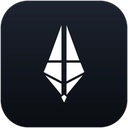
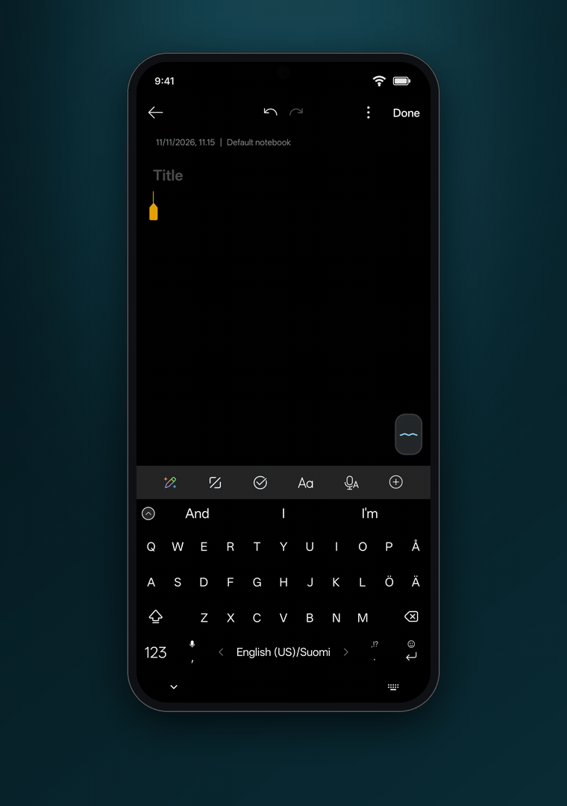
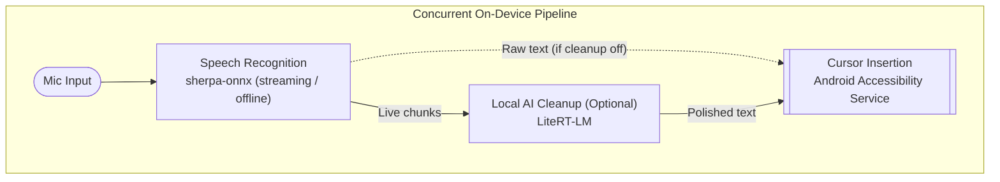
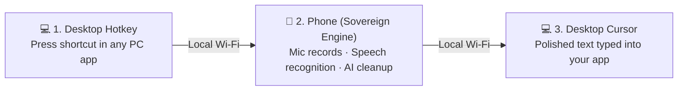
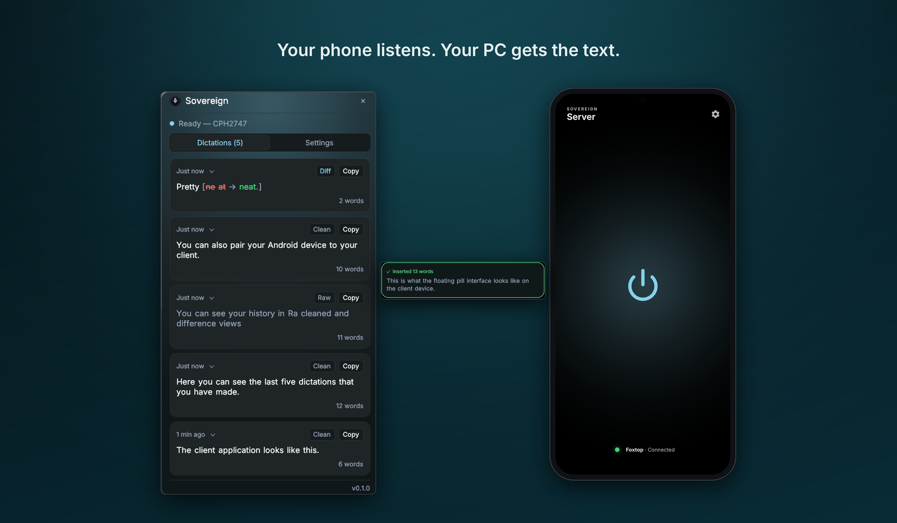
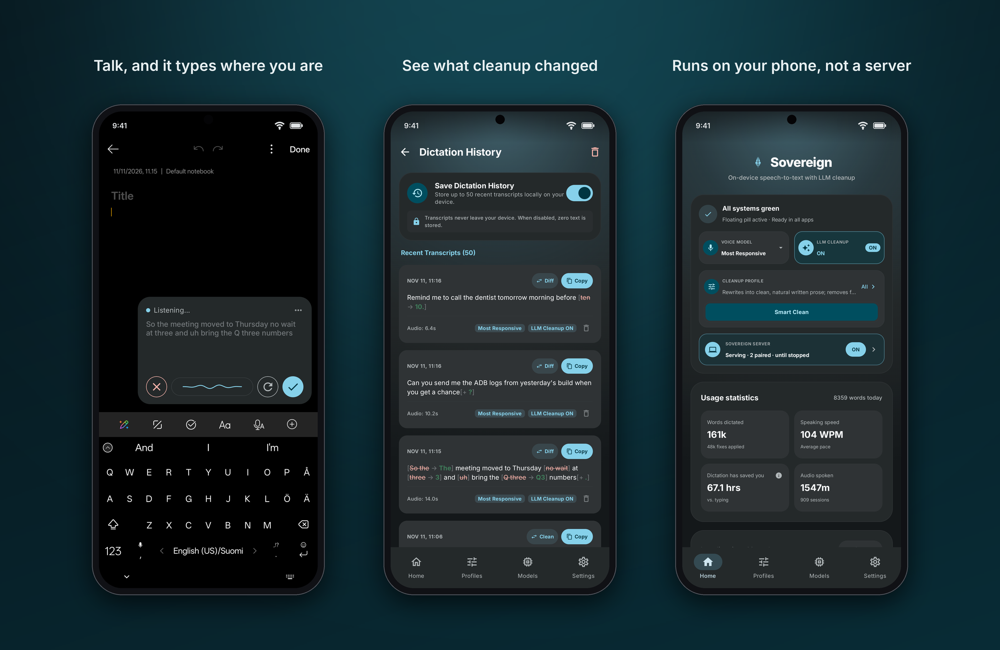
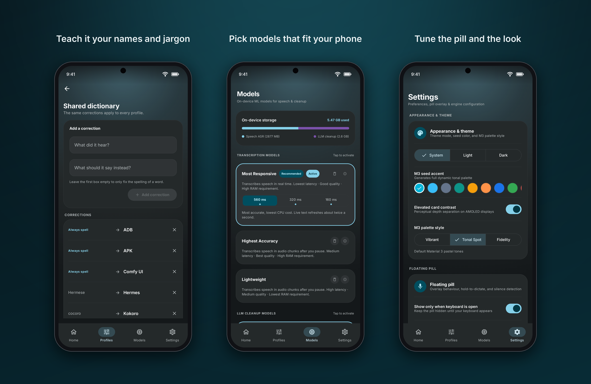
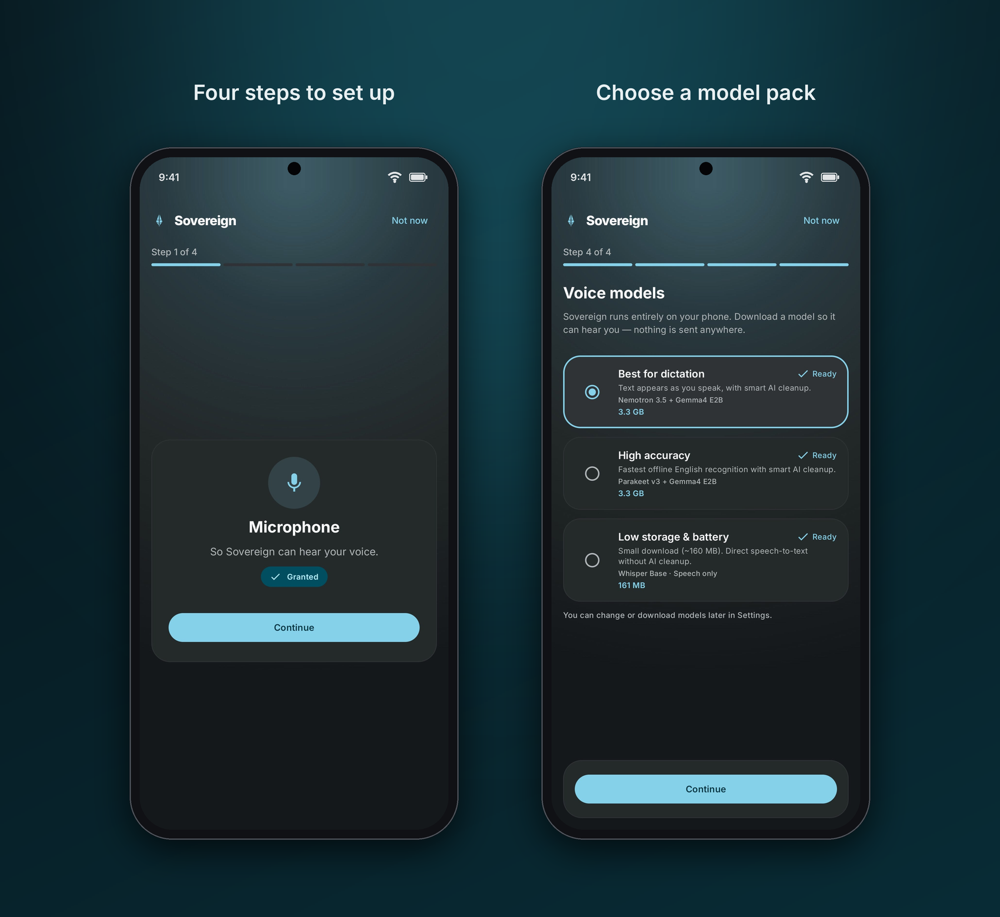
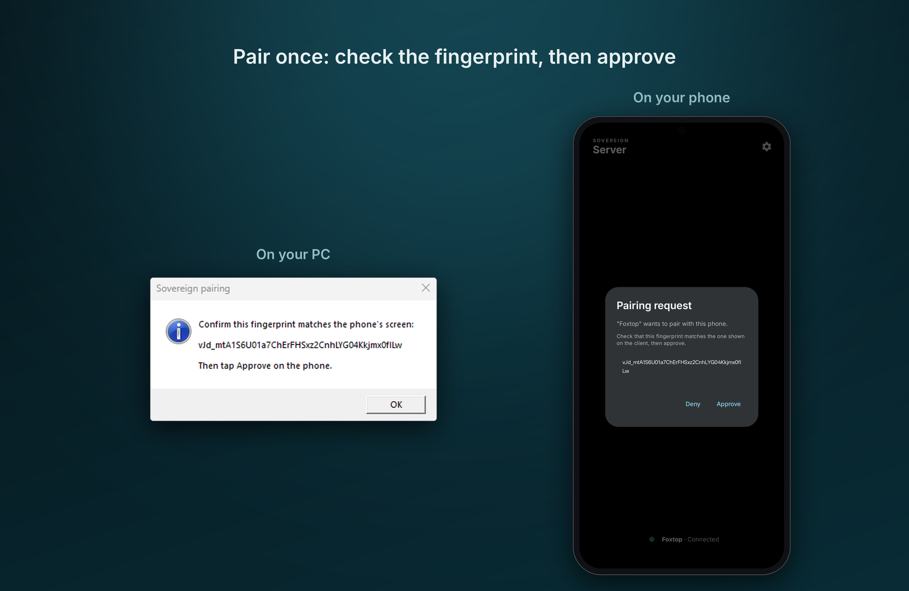
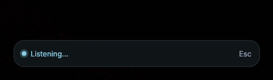

<p align="center">
  
</p>

<h1 align="center">Sovereign</h1>
<p align="center"><strong>Smart Dictation &amp; Transcription</strong><br/>
Speech-to-text that runs on your own devices — no cloud, no account.</p>

<p align="center">
  
  
  
  
</p>

**Sovereign** is an on-device, private speech-to-text dictation tool for Android and your desktop. A floating pill sits over any app—tap or hold to speak, and your words appear at your cursor, cleaned and formatted in real time by an AI model running on your Android phone.

Everything runs on your hardware. Zero cloud, zero subscriptions, zero audio leaving your devices.

<p align="center">
  
</p>

## Why Sovereign

- **Sovereign by design.** No cloud, no accounts, no telemetry. Your voice and data never leave your devices, and no internet connection is required after initial download of the models.
- **Designed for low latency.** Sovereign doesn't wait for you to stop speaking before starting to process your speech. Recognition and AI cleanup run concurrently in an overlapped pipeline—transcribing and cleaning the output while you are still speaking.
- **One app for all your dictation needs.** The phone is both your portable microphone and your AI compute engine. The lightweight desktop client connects to it securely over your local network, giving your computer full dictation capabilities even if it has no microphone or AI capable hardware.
- **Works in any app.** Powered by Android's accessibility service, Sovereign types wherever a cursor can blink—browsers, notes, chats, and terminals. No keyboard to switch to.
- **Sounds like you, only tidier.** An on-device language model removes filler words, repairs self-corrections, sorts out punctuation, and respects a personal dictionary of names and jargon you use.
- **Auditable and in your control.** Apache-2.0 licensed. Model weights are downloaded on demand directly from their original publishers (Hugging Face / Google), the code is transparent, and you own the entire stack.


## How it works

### Concurrent On-Device Pipeline

Recognition and cleanup run natively on your phone's CPU and GPU. Rather than waiting for you to finish speaking before starting, the pipeline processes speech concurrently in chunks—transcribing and refining as you talk, so text is ready to insert at your cursor almost instantly when you finish. AI cleanup is optional: switch it off and Sovereign types exactly what the speech model heard, with no language model running.



### Multi-Device Dictation Hub

Your phone acts as a standalone dictation server for your desktop. When you press your desktop shortcut, the computer signals your phone over your local network to start listening. The phone's microphone records your voice, its local models transcribe and clean the text, and the finished text is sent straight back to your computer's active cursor.

Your computer needs no AI capable hardware, no specialized GPU, and no working microphone. No internet connection is used, and no data leaves your local Wi-Fi.



<p align="center">
  
</p>


## Features

<p align="center">
  
  
</p>

**Dictation**
- Floating pill overlay that works across all apps with clear idle, recording, and cleaning states
- Tap to start/stop, or **hold to talk** (push-to-talk, release to insert)
- Live transcript card showing streaming text as you speak
- Support for both ultra-low-latency streaming and high-accuracy offline models

**Desktop Client**
- Lightweight desktop client (Windows first) that dictates directly into your computer
- Global keyboard shortcut triggers phone dictation into whatever window is focused
- Simple one-time local pairing (no cloud accounts, no network configuration)
- Works on PCs with no microphone or no AI capable hardware

**Cleanup & Vocabulary**
- On-device AI cleanup with the built-in **Smart Clean** profile, plus custom user profiles
- Personal dictionary of names, acronyms, and technical jargon that the AI cleanup model uses to spell them your way (applies when cleanup is on)
- Word-level diff viewer showing exactly what AI cleanup altered or removed

**Privacy & Control**
- Optional dictation history that can be disabled entirely for zero data retention
- Local history of your 50 most recent dictations when enabled, clearable at any time
- Single-file JSON backup and restore for settings, profiles, and dictionary

**Tools & Diagnostics**
- Built-in hardware benchmarking to test your device's transcription and AI inference speed
- In-app model manager with one-tap downloads and storage meters
- Audio file transcription tool and testing sandbox


## Getting Started

### 1. Install on Android

1. Download the latest `sovereign-*.apk` from the [releases page](https://github.com/AlexeiKramm/sovereign/releases/latest).
2. Open the APK on your phone and allow installation from your browser or file manager when prompted.
3. *(Optional)* Verify integrity: check the APK against the SHA-256 published on the release page.

### 2. First-Run Setup

When you first launch Sovereign, the setup wizard walks you through granting permissions and downloading your models:

1. **Microphone** — Needed to capture your voice for speech recognition. All audio is processed strictly on-device.
2. **Display over other apps** — Needed to draw and interact with the floating dictation pill on top of your other apps.
3. **Accessibility Service** — Needed so Sovereign can detect active text fields and insert your dictation right at your text cursor.
4. **Choose Model Pack** — Select an initial bundle based on your phone's storage and speed (see [Models](#models)). Notification permission is requested so downloads complete reliably in the background without Android killing the process.

<p align="center">
  
</p>


### 3. Connect Desktop Client (Optional)

Turn your phone into a dictation microphone for your PC:

1. **Start the Phone Server:** In Sovereign on your phone, open the **Home** tab and tap the **Sovereign Server** card to open the server dashboard (or switch it on from the card directly). The server starts listening on your local Wi-Fi.
2. **Launch the Desktop Client:** Download `sovereign-client.exe` from the [releases page](https://github.com/AlexeiKramm/sovereign-client/releases/latest) on your Windows PC and open it (it runs in your system tray).
3. **One-Tap Pairing:** Right-click the tray icon and choose **Pair with phone…** (the same button is in the control window's **Settings** tab). The client finds your phone on the network by itself. Your phone shows a pairing request with your PC's name and a fingerprint; check that it matches the one on your PC, then tap **Approve**.
4. **Dictate:** Place your cursor into any app on your PC (Word, browser, code editor, chat), press `Ctrl+Alt+Space`, and speak into your phone. The transcribed, cleaned text types directly at your PC cursor.

<p align="center">
  
</p>

The desktop client shows the same live state as the pill on your phone, and confirms how many words landed:

<p align="center">
  
</p>


## Models

Sovereign bundles **no model weights**. The setup wizard offers three ready-made packs; individual models can also be swapped or downloaded separately under **Models**. All models run entirely on your phone—the desktop client requires no downloads and uses the phone's models.

| Pack | Speech Recognition | AI Cleanup | Total Download | Best For |
|---|---|---|---|---|
| **Best for dictation** | Nemotron 3.5 Streaming (560 ms, ~682 MB) | Gemma 4 E2B (~2.6 GB) | ≈ 3.3 GB | Live streaming dictation with on-device AI cleanup (8 GB+ RAM recommended) |
| **High accuracy** | Parakeet v3 (offline, ~670 MB) | Gemma 4 E2B (~2.6 GB) | ≈ 3.3 GB | High-accuracy transcription with AI cleanup (8 GB+ RAM recommended) |
| **Low storage &amp; battery** | Whisper Base (offline, ~160 MB) | None | ≈ 160 MB | Lowest RAM and storage usage; runs smoothly on 6 GB devices |

**Speech recognition models:**

| In the app | Model | Kind | Size | Practical Experience |
|---|---|---|---|---|
| **Most Responsive** | Nemotron 3.5 Streaming, 560 / 320 / 160 ms chunks | Streaming | ~682 MB per chunk size | Text appears live as you speak; smaller chunks update the live text more often |
| **Highest Accuracy** | Parakeet v3 | Offline | ~670 MB | Fast and highly accurate; transcribes during natural pauses |
| **Lightweight** | Whisper Base | Offline | ~160 MB | Minimal storage and RAM; transcribes during natural pauses |

The *Best for dictation* pack installs the 560 ms version of Nemotron; the other chunk sizes can be downloaded and switched under **Models**.

**AI cleanup models (optional):**

| Model | Size | Hardware Notes |
|---|---|---|
| Gemma 4 E2B (default) | ~2.6 GB | Fast on-device cleanup with balanced quality (GPU accelerated; runs well on 8 GB+ RAM) |

> **Hardware & RAM:** Devices with 8 GB RAM (such as older flagships or modern mid-range phones) comfortably run both speech recognition and Gemma 4 E2B concurrently. For devices with 6 GB RAM, running speech recognition without AI cleanup (or paired with Whisper Base) is recommended. Higher-end devices run recognition and cleanup effortlessly.

> **Languages:** The underlying models and pipeline support multiple languages and automatic language detection. However, development and testing have so far focused on English, so transcription quality in other languages has not been evaluated yet.

All models are downloaded directly from their original publishers (Hugging Face / Google) and verified by SHA-256 checksum. See `ATTRIBUTIONS.md` for upstream model licenses.


## Privacy

- **Audio stays in memory on your phone.** Voice recordings are processed live in RAM and are never written to disk or sent to any cloud service.
- **Strictly local network communication.** When dictating to your computer, data stays entirely inside your Local Area Network (LAN / Wi-Fi) over an encrypted peer-to-peer connection. Nothing ever routes through external internet servers or third-party infrastructure.
- **Zero telemetry, zero tracking.** Sovereign contains no third-party analytics SDKs, no telemetry, and requires no account creation.
- **Internet access is solely for models.** The only outbound internet traffic occurs when you explicitly initiate a model download from its public repository.
- **Transparent local storage:** Your custom dictionary, cleanup profiles, settings, and optional dictation history live exclusively in your phone's private app sandbox. You can export everything as a portable JSON file or wipe it completely at any time.

## Requirements & Compatibility

| Component | Requirement | Notes |
|---|---|---|
| **Android OS** | Android 11 (API 30) or newer | Supported on essentially all modern Android devices |
| **Device Tier** | Mid-range to flagship recommended | Older flagships (e.g. OnePlus 7 Pro) and modern mid-rangers handle live dictation and AI cleanup comfortably |
| **Phone RAM** | 6 GB minimum; 8 GB+ recommended | 6 GB devices run transcription-only models smoothly; 8 GB+ allows concurrent on-device AI cleanup |
| **Storage** | ~300 MB to ~3.5 GB | ~300 MB for the app + the Low storage pack; ~3.5 GB for the recommended pack; ~5.6 GB if you download every offered model |
| **Permissions** | Microphone, Overlay, Accessibility | Required for voice capture, floating pill UI, and inserting text at your cursor |
| **Network** | None for phone; Local Wi-Fi for PC | Phone dictation is 100% offline. Desktop companion requires both devices on the same local network |
| **Desktop Companion** | Windows 10 / 11 | Other desktop operating systems may follow based on community demand |
| **Root Access** | Not required | Standard sideloaded APK |


## FAQ & troubleshooting

**The pill doesn't appear.**
By default the pill only shows while a keyboard is open, so tap into a text field first (you can
change this under **Settings → Floating pill**). If it still doesn't show, re-enable
**Sovereign Dictation Service** in Android's accessibility settings. Updating or force-stopping the
app clears this, and Android sometimes disables accessibility services automatically.

**Dictation stops working after a while.**
Some ROMs aggressively kill background services. Exempt Sovereign from battery optimization.

**"No model" / nothing happens when I speak.**
Open **Models** and finish the download for your selected recognition model.

**Can I use it without the AI cleanup?**
Yes — choose the **Low storage & battery** pack, or switch **LLM Cleanup** off on the Home tab. Cleanup is always optional.

**My banking or security-sensitive app refuses to open.**
Certain high-security applications (such as mobile banking, government ID, or corporate authenticator apps) actively detect third-party accessibility services and block startup as a safeguard against malicious screen overlays. If a security-strict app refuses to open, temporarily disable **Sovereign Dictation Service** in Android's Accessibility settings while using that app, then turn it back on when finished.


## Build from source

Requirements: **JDK 17** and the **Android SDK** (`compileSdk 36`), or a standard installation of **Android Studio**.

The repository includes the Gradle Wrapper, so you do not need to install Gradle manually. Because the sherpa-onnx native Android runtime is not distributed via Maven Central, run the fetch script once before building.

**Linux / macOS / Git Bash:**
```bash
git clone https://github.com/AlexeiKramm/sovereign.git
cd sovereign
tools/fetch_sherpa_aar.sh          # ~48 MB native runtime, sha256-verified
./gradlew :app:assembleDebug
# APK: app/build/outputs/apk/debug/app-debug.apk
```

**Windows (PowerShell):**
```powershell
git clone https://github.com/AlexeiKramm/sovereign.git
cd sovereign
.\tools\fetch_sherpa_aar.ps1       # ~48 MB native runtime, sha256-verified
.\gradlew.bat :app:assembleDebug
# APK: app\build\outputs\apk\debug\app-debug.apk
```

> **Android Studio:** You can also open the cloned folder in Android Studio after running the fetch script. Android Studio will automatically recognize the project and configure the SDK.

## Project layout

```
app/src/main/java/io/github/alexeikramm/sovereign/
  floating/   floating overlay pill & accessibility cursor insertion
  dictation/  overlapped pipeline coordinating audio capture, ASR, and AI cleanup
  asr/        on-device speech recognition via sherpa-onnx (streaming & offline)
  cleanup/    on-device LLM cleanup via LiteRT-LM (Gemma models & prompt core)
  download/   background model downloader via Android WorkManager
  data/       local settings, custom dictionary, profiles, and dictation history
  server/     phone-as-desktop-server: wss:// endpoint, TLS identity, and pairing
  ui/         Compose screens (Home · Profiles · Models · Settings) and setup wizard
  theme/      Material 3 color, typography, and motion tokens
  engine/     choice between the on-device engine and the legacy server tier
  text/ audio/ device/   text finalization, PCM audio capture, hardware info
```

Unit tests mirror this layout under `app/src/test/`. The desktop companion client lives in a separate repository.

## Contributing & bug reports

Issues and pull requests are welcome on
[GitHub](https://github.com/AlexeiKramm/sovereign/issues). When reporting a bug, please include
your phone model, Android version and the app's build label (shown in **Settings**).

## License

Sovereign is released under the [Apache-2.0 License](LICENSE). Third-party components and their
licenses are listed in [ATTRIBUTIONS.md](ATTRIBUTIONS.md).
